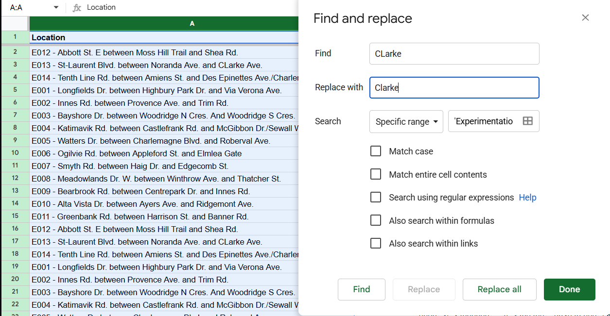
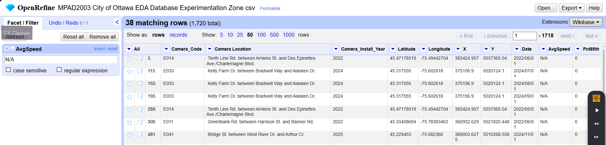
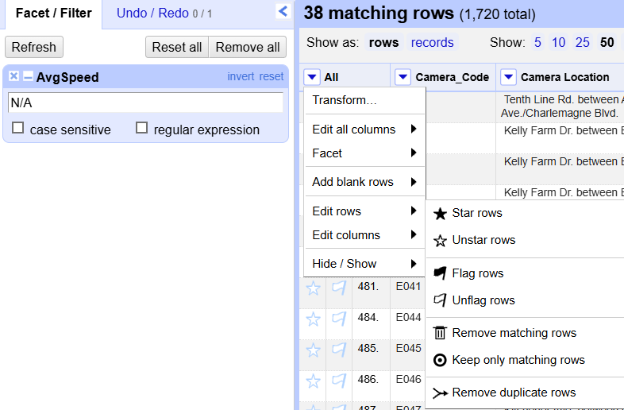
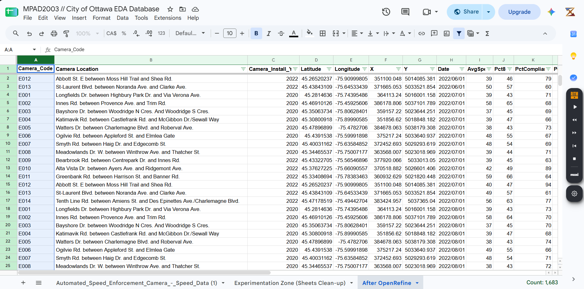
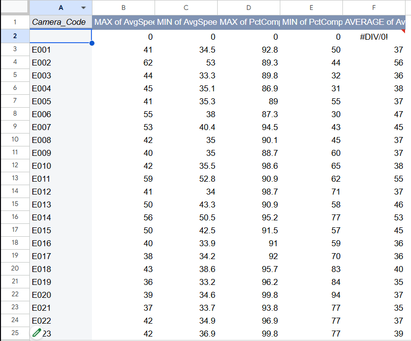
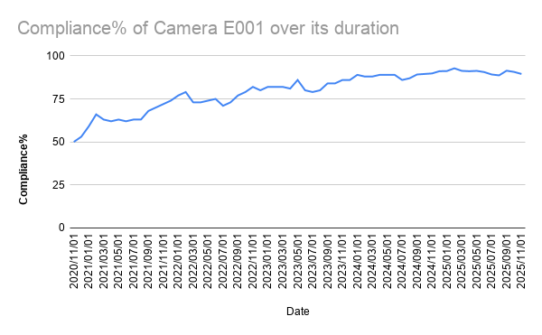

**November 5th, 2026**<br>
**MPAD 2003 A**<br>
**Saiyon Mok**<br>
**Presented to Jean-Sébastien Marier**<br>

# Deliverable 2: Exploratory Data Analysis (EDA) - MPAD 2003 A

Exploratory Data Analysis (EDA) concerning Automated Speed Enforcement Cameras in the City of Ottawa

## 1. Getting Data

### Context
This EDA acts as a follow-up to MPAD 2003 A's first assignment, which involved the introduction of a specific City of Ottawa dataset to create a data story from.

I chose a database about Automated Speed Enforcement (ASE) cameras, plotting the locations of all ASE cameras that existed in the city of Ottawa up until November 1st, 2025.

### Importing the database

#### Database Link
[Automated Speed Enforcement Camera - Speed Data](https://open.ottawa.ca/datasets/432723dbabc64909a075956eccd4ee03_0/explore?location=45.277107%2C-75.756363%2C5)

#### Process

To import the dataset, we can navigate towards the dataset with the provided link above.

<br>

Head over to the left panel and hit the download button, just below the database's summary section.

<br>

Now, a dropdown selection on the panel with multiple formats. I will elect to download it as a .csv file.

<br>

We are now able to open it with Google Sheets.

<br>

#### Observations


#### Spreadsheet Link
[MPAD2003 // City of Ottawa EDA Database](https://docs.google.com/spreadsheets/d/1f-K3tJ7xI2piDXfMJbYoD6t6VikYi9w_U7Z1MIbGSxg/edit?usp=sharing)

There are 12 columns and 1720 rows excluding the column titles.

Camera locations are prefixed as "E### - Location" and have consistent installment year, coordinates, and recording date formatting. Speed measurements are wonky, but do not go above 2 decimals.

There exist 1720 total data entries on specific batch dates for. Column A denotes which specific camera said entry correlates to.

Column G will then determine the date of which the data entry was created.

Then, four columns to the right of Column G are measurements that have been compiled from the camera's installment, up to its data entry creation. Column H denotes the total average speeds a camera has measured.

#### Potential questions

1. Which areas have a higher proportion of violators?
2. Where do high-end speeders proliferate?

## 2. Understanding Data

### 2.1. VIMO Analysis

According to the Government of Canada, a VIMO analysis is representative as an acronym when first analyzing data, referring to variables that can be classified as Valid, Invalid, Missing, or Outlier variables (Government of Canada, 2020).

Using VIMO to analyze data can be crucial in ensuring the accuracy of data as it must adequately reflect reality and cannot include any blank and missing values (Government of Canada, 2020).

All entries have a corresponding location in column A, all camera installment years are between 2020-2025, all Earth coordinates and longitudinal/latitudinal values are within the same proximity, and all listed data entry dates are between 2020-2025 with no month values surpassing 12 and going below 1.

Something to look out for is past column G and into the recorded speed values. There do exist invalid “N/A” values in AvgSpeed and PctCompliance, then affecting the Pct85th and PctHighEndSpeeders values to be set to 0.

### 2.2. Cleaning Data

For the purposes of cleaning this dataset, I will make a duplicate of it which I will dub the Experimentation Zone to distinguish it from what it first looked like during the initial import.


#### Cleaning in Google Sheets

I will first start cleaning the dataset within Google Sheets. There exist a few inconsistencies for column A in relation to whitespacing for the locations of cameras, which Google Sheets can automatically fix.


With that done, I will then adjust all column lengths to fit the text proportions, but that now leaves me with a colossal column A that houses both a general location and camera code. 

First I will correct some capitalization of the locations using the find and replace tool and then split the column in 2 by inserting 2 new columns to its right alongside the =SPLIT function. Since “ - ” is the separator, I will have to replace that with “ > ” as road names may be hyphenated.



Ultimately the 1st set of brackets is redundant, but I put it in as such:
``` r
=(SPLIT(A2, ">"))
```


The split variables are pasted back as pure values, and column A is deleted. 

Now, I want to attempt to get rid of some invalid or missing values with OpenRefine. This is what the dataset looks like currently:


I will now redownload this spreadsheet as a .csv and then open it as a project on OpenRefine. I will then select the dropdown menu of the AvgSpeed column and navigate towards the text filter. This will now open a side panel that I can insert N/A into and get all rows which have that.





I will then remove all matching rows, remove the text filter, and redownload the dataset as a .csv to reopen in a new section of my Google Sheet called “After OpenRefine”.



We now have a fully cleaned dataset.

### 2.3. Analyzing Data


This analysis component of this EDA will now include a pivot table and exploratory chart.


#### Pivot Table


*Figure 1: Cameras E001-E060 and MAX average speeds, MIN average speeds, MAX compliance%, MIN compliance%, and AVERAGE speeds over their existence*

This pivot table primarily covers all unique camera codes and compiles the maximum/minimum average speeds and compliance percentages recorded for every data entry.

I'm mainly curious on potential outlying numbers and if there would be any extremes, but minimums and maximums can be dependent on the nature of the area a camera is placed in; mainly its speed limit.

Another thing is if we can attribute any extreme recorded numbers to a specific date. For example, if there was an outlying very low percentage of compliance for a given camera, would this have occured just after the camera was been installed or during its first recorded data entry?

#### Exploratory Chart


*Figure 2: Camera E001's AVERAGE speed between all recorded entry dates*

More on comparing values of a camera from given dates, this exploratory chart analyzes the relation of a singular camera, E001's compliance% over its many data entries from 2020-2025.

We are also able to look at specific camera locations over their entire existence instead of just multiple cameras within one timeframe.

Here demonstrates a steady increase into a plateau around 90% compliance after starting with 50%. This makes sense, as not everyone will be aware of an ASE camera right away, but as time passes, awareness progressively climbs and along with it, compliance does too.

A question that I'd have in relation for this would be if other cameras would have very similar patterns. 

Is the 90% area really the equilibrium once people have adjusted? Would cameras installed during the later years ASE was introduced share this same low initial compliance percentage, or would it not be as low since ASE has already had some time to be introduced to the city?

## 3. Delivering Data

A large portion of this story would probably have to compare statistics of what it was like having ASE in that 5 year stretch in comparison to the immediate aftermath. 

A large part of how ASE affected Ottawa can only be completed when we have access to measured data when it comes to Ottawa’s driving habits with a lack thereof, especially since ASE has now been decommissioned.

My next course of research would then start with mainstream reports on how stakeholders react with the changes that decommissioning ASE has brought, such as Ottawa police’s struggles with city enforcement coverage without automated enforcement as highlighted in both Justin Ball and Lynn Saxberg’s articles (Ball, 2026; Saxberg, 2026), or considering how Ottawa might struggle with developing physical traffic calmers up until 2027 as per Ted Raymond’s article (Raymond, 2026). 

Though I do not know specific people for potential interviews, it’d be best to have it geared towards stakeholders of that calibre, such as a concerned neighborhood parent or school principal who has been able to observe a notable difference in driver behavior, or a police officer who has prior knowledge of how ASE systems might have or have not assisted road safety enforcement.

## 4. References

Ball, J. (2026, November 3). Speed camera ban makes traffic enforcement harder, says Ottawa police chief. CBC Lite. Retrieved November 5, 2026, from [https://www.cbc.ca/lite/story/9.7406785](https://www.cbc.ca/lite/story/9.7406785)
Government of Canada. (2020, September 23). Data Accuracy and Validation: Methods to ensure the quality of data. Statistics Canada. [https://www.statcan.gc.ca/en/wtc/data-literacy/catalogue/892000062020008](https://www.statcan.gc.ca/en/wtc/data-literacy/catalogue/892000062020008)
Raymond, T. (2026, November 4). Traffic calming at former speed camera sites in Ottawa not expected to be complete until end of 2027: City. CTV News. [https://www.ctvnews.ca/ottawa/article/traffic-calming-at-former-speed-camera-sites-in-ottawa-not-expected-to-be-complete-until-end-of-2027-city/](https://www.ctvnews.ca/ottawa/article/traffic-calming-at-former-speed-camera-sites-in-ottawa-not-expected-to-be-complete-until-end-of-2027-city/)
Saxberg, L. (2026, November 3). Ottawa police can't compete with speed cameras in traffic enforcement. Ottawa Citizen. Retrieved November 5, 2026, from [https://ottawacitizen.com/news ottawa-police-need-new-officers-to-enforce-school-zone-speeding](https://ottawacitizen.com/news-ottawa-police-need-new-officers-to-enforce-school-zone-speeding)
