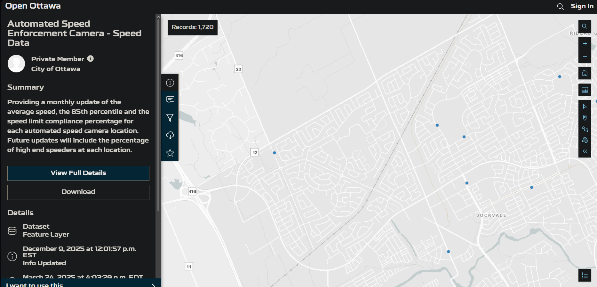
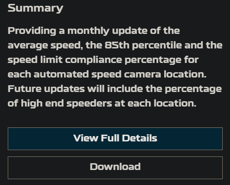
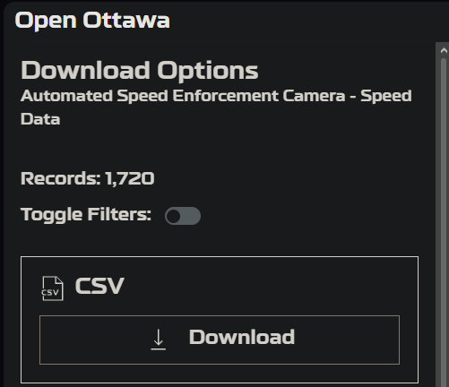
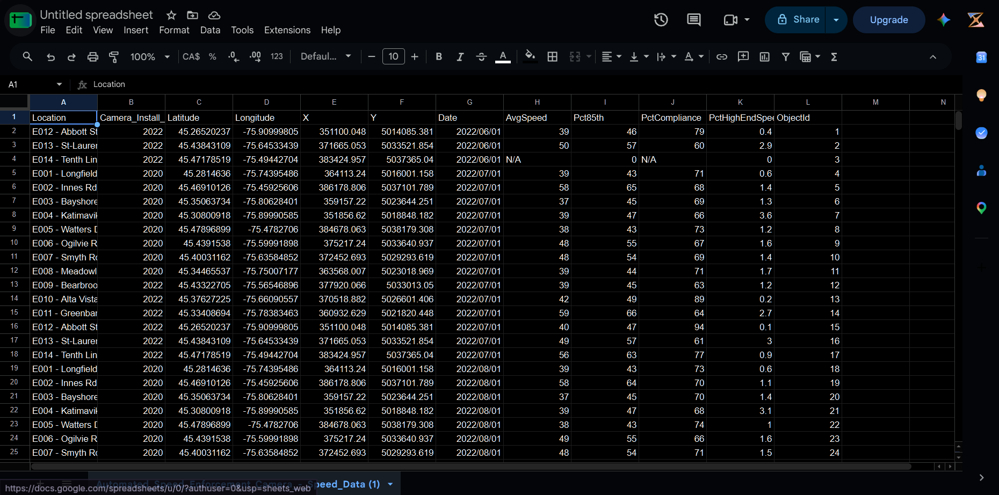
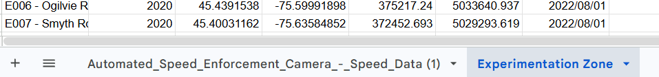
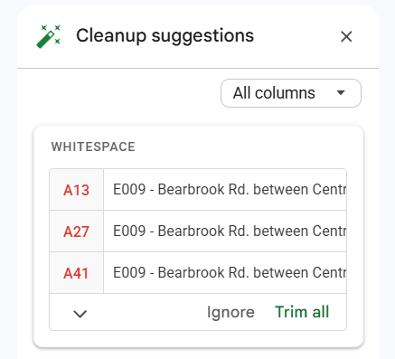
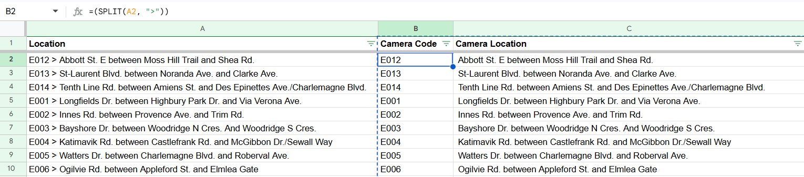
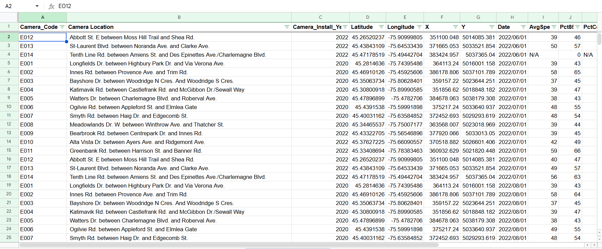
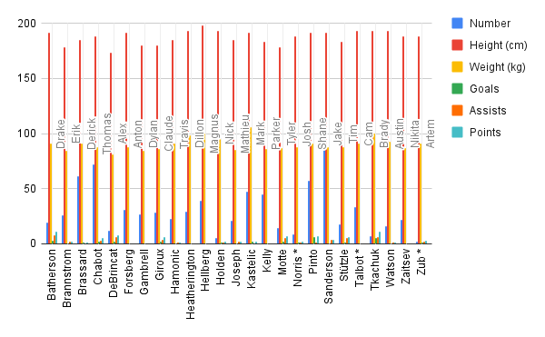

**November 5th, 2026**<br>
**MPAD 2003 A**<br>
**Saiyon Mok**<br>
**Presented to Jean-Sébastien Marier**<br>

# Deliverable 2: Exploratory Data Analysis (EDA)

## Foreword

For this assignment, you must clean and analyze the dataset from Deliverable 1, create exploratory charts/visualizations, and identify a potential story. Your assignment must clearly detail your process. You are expected to write about 1,000-1,200 words, and to include several screen captures showing the different steps you went through. Your assignment must be written with the Markdown format and submitted on GitHub.

I have been assigning different versions of this project to my digital journalism and data storytelling students for a few years now. Its structure was inspired by the main sections/chapters of [*The Data Journalism Handbook*](https://datajournalism.com/read/handbook/one/). This version was further inspired by the [Key Capabilities in Data Science](https://extendedlearning.ubc.ca/programs/key-capabilities-data-science) program offered by the University of British Columbia (UBC).

**Here are some useful resources for this assignment:**

* [GitHub's *Basic writing and formatting syntax* page](https://docs.github.com/en/get-started/writing-on-github/getting-started-with-writing-and-formatting-on-github/basic-writing-and-formatting-syntax)
* [The template repository for this assignment in case you delete something by mistake](https://github.com/jsmarier/jou4100_jou4500_mpad2003_project2_template)

Did you notice how to create a hyperlink? In Markdown, we put the clickable text between square brackets and the actual URL between parentheses.

And to create an unordered list, we simply put a star (`*`) before each item.

## 1. Getting Data

### Context
This EDA acts as a follow-up to MPAD 2003 A's first assignment, which involved the introduction of a specific City of Ottawa dataset to create a data story from.

I chose a database about Automated Speed Enforcement (ASE) cameras, plotting the locations of all ASE cameras that existed in the city of Ottawa up until November 1st, 2025.

### Importing the database

#### Database Link
[Automated Speed Enforcement Camera - Speed Data](https://open.ottawa.ca/datasets/432723dbabc64909a075956eccd4ee03_0/explore?location=45.277107%2C-75.756363%2C5)

#### Process

To import the dataset, we can navigate towards the dataset with the provided link above.

<br>

Head over to the left panel and hit the download button, just below the database's summary section.

<br>

Now, a dropdown selection on the panel with multiple formats. I will elect to download it as a .csv file.

<br>

We are now able to open it with Google Sheets.

<br>

#### Observations


#### Spreadsheet Link
[MPAD2003 // City of Ottawa EDA Database](https://docs.google.com/spreadsheets/d/1f-K3tJ7xI2piDXfMJbYoD6t6VikYi9w_U7Z1MIbGSxg/edit?usp=sharing)

There are 12 columns and 1720 rows excluding the column titles.

Camera locations are prefixed as "E### - Location" and have consistent installment year, coordinates, and recording date formatting. Speed measurements are wonky, but do not go above 2 decimals.

There exist 1720 total data entries on specific batch dates for. Column A denotes which specific camera said entry correlates to.

Column G will then determine the date of which the data entry was created.

Then, four columns to the right of Column G are measurements that have been compiled from the camera's installment, up its data entry creation. Column H denotes the total average speeds a camera has measured.

#### Potential questions

1. Which areas have a higher proportion of violators?
2. Where do high-end speeders proliferate?

## 2. Understanding Data

### 2.1. VIMO Analysis

According to the Government of Canada, a VIMO analysis is representative as an acronym when first analyzing data, referring to variables that can be classified as Valid, Invalid, Missing, or Outlier variables (Government of Canada, 2020).

Using VIMO to analyze data can be crucial in ensuring the accuracy of data as it must adequately reflect reality (Government of Canada, 2020). When data is considered accurate, it means it is correctly representative of reality and cannot include any blank and missing values (Government of Canada, 2020). 

After a quick scroll of the dataset in its entirety, the majority of it seems rather fine. All entries have a corresponding location in column A, all camera installment years are between 2020-2025, all Earth coordinates and longitudinal/latitudinal values are within the same proximity, and all listed data entry dates are between 2020-2025 with no month values surpassing 12 and going below 1.

Something to look out for is past column G and into the recorded speed values. There do exist invalid “N/A” values in AvgSpeed and PctCompliance, then affecting the Pct85th and PctHighEndSpeeders values to be set to 0. Those data entries will then have to be cleaned up.

### 2.2. Cleaning Data

For the purposes of cleaning this dataset, I will make a duplicate of it which I will dub the Experimentation Zone to distinguish it from what it first looked like during the initial import.



#### Cleaning in Google Sheets

I will first start cleaning the dataset within Google Sheets. There exist a few inconsistencies for column A in relation to whitespacing for the locations of cameras, which Google Sheets can automatically fix.



With that done, I will then adjust all column lengths to fit the text proportions, but that now leaves me with a colossal column A that houses both a general location and camera code. 

First I will correct some capitalization of the locations using the find and replace tool and then split the column in 2 by inserting 2 new columns to its right and then using the =SPLIT function. Since “-” is the separator, I will have to replace that with “>” as road names may be hyphenated.

``` r
=(SPLIT(AS, ">"))
```



Values are then pasted as such, and column A is deleted. 

Now, I want to attempt to get rid of some invalid or missing values with OpenRefine. This is what the dataset looks like currently:




### 2.3. Analyzing Data

Insert text here.

**This section should include a screen capture of your pivot table, like so:**

<br>
*Figure 2: This pivot table shows...*

**This section should also include a screen capture of your exploratory chart, like so:**

<br>
*Figure 3: This exploratory chart shows...*

## 3. Delivering Data

Insert text here.

## 4. References

Include a list of your references here. Please follow [APA](https://apastyle.apa.org/style-grammar-guidelines/references) or [MLA](https://www.mla.org/MLA-Style) guidelines for references. Hanging paragraphs aren't required though.

**Here's an example:**

Bounegru, L., & Gray, J. (Eds.). (2021). *The Data Journalism Handbook 2: Towards A Critical Data Practice*. Amsterdam University Press. [https://ocul-crl.primo.exlibrisgroup.com/permalink/01OCUL_CRL/hgdufh/alma991022890087305153](https://ocul-crl.primo.exlibrisgroup.com/permalink/01OCUL_CRL/hgdufh/alma991022890087305153)
